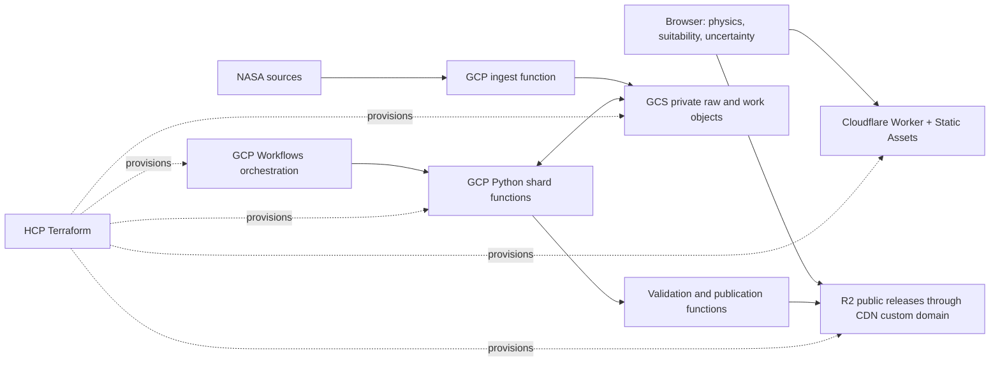

# Cloud-native architecture and migration plan

Status: proposed implementation plan. Date: 2026-11-15.
No infrastructure is provisioned by this document.

## 1. Decisions and scope

Adopt a browser-first product with Cloudflare delivery, R2 public datasets, GCP functions for bounded offline scientific processing, and Terraform-managed infrastructure. Use Just as the command interface on native Windows, Linux, and macOS. Keep Python and its shared scientific library for data preparation and reference validation; retire the FastAPI product runtime after feature migration.

Requirements:

- Terraform owns infrastructure. HCP Terraform is the preferred remote state and execution service.
- Native development and cloud deployment do not require GNU Make, Bash, WSL, Docker, or rsync.
- A second, equally supported mode runs the complete product and scientific pipeline locally using only Docker with Compose. No host Node, Python, uv, Just, Terraform, cloud CLI, cloud credentials, or cloud services are required in this mode. Docker's own platform prerequisites still apply.
- Large durable artifacts live in object storage: GCS for private processing inputs/intermediates, R2 for published browser products.
- Application and scientific cloud execution use functions only. No VMs, Kubernetes, custom container services, or Cloud Run Jobs.
- GCP Cloud Run **functions** are allowed; an independently deployed Cloud Run container service is not. Provider-managed function builds can internally use containers without making Docker a developer requirement.
- Managed build/CI systems and HCP Terraform are auxiliary tooling, not places to hide the production scientific pipeline.
- The functions-only restriction applies to cloud deployment. Local Compose may use ordinary containers to implement the same application, storage, and processing contracts.

This proposal supersedes the local-demo/cloud-stub direction of ADR-004 in [DECISIONS.md](./DECISIONS.md) when implementation is adopted.

## 2. Target topology



| Component | Responsibility | Explicit boundary |
|---|---|---|
| Preact/Vite browser app | Site metrics, maps, panorama, suitability, candidate selection, region analysis, shortlisted-candidate uncertainty | No Python API needed for normal use |
| Cloudflare Worker + Static Assets | Small app bundle, runtime configuration, SPA routing | No scientific array processing |
| R2 + custom domain | Immutable public tiles, ephemerides, catalogs, horizon chunks, reference heatmaps | No private raw sources, credentials, or mutable job state |
| GCS | Raw scientific inputs, intermediate shards, function source archives, validation reports | Durable processing storage; not a POSIX shared disk |
| GCP Python functions | Bounded ingestion, transformation, validation, publication | No request loads the entire dataset or assumes a warm instance |
| GCP Workflows | Explicit dependencies, bounded fan-out, retries, completion checks | Orchestration only; scientific work stays in functions |
| HCP Terraform | Environment state, locking, plans, applies | Not a dataset uploader |

Rationale: keep the existing browser work and Python science code, use R2 for public delivery, and keep Python native dependencies on GCP rather than assume they run unchanged in Workers. Workers currently have a 128 MB isolate memory limit [S3]. GCP-to-R2 publication adds transfer cost and operational complexity; transfer only validated changed artifacts, not every intermediate.

A GCP-only alternative can serve published objects from GCS behind an HTTPS load balancer/CDN and use the same browser contracts. Do not build both delivery implementations initially. The recommended first implementation is Cloudflare delivery plus GCP processing.

## 3. Feature migration: preserve value explicitly

| Existing capability | Target | Retirement condition |
|---|---|---|
| Browser site metrics/live suitability | Keep current workers and WebGL paths | Regression and scientific tests pass |
| API site metrics | Keep Python as offline reference; browser remains interactive implementation | No frontend dependency; documented external API removal |
| API region overview | Browser analysis over tiled precomputed horizons/features | Supported extent and dates work without API, within measured budgets |
| Prebuilt heatmaps | Keep as labeled reference scenarios and optional low-power fallback | Never present nearest-date products as exact requested results |
| API terrain-uncertainty robustness | Port to a browser worker for a bounded shortlist | Seeded Python/browser comparisons with declared numerical tolerances |
| API info/health | Static dataset manifest and browser capability checks | No startup API probing or misleading offline badge |
| Texture generation stub | Remove from deployment scope | No runtime dependency |

Do not claim exact parity merely because both paths produce a suitability image. Define grid resolution, azimuth count, observer height, footprint treatment, interval sampling, hard constraints, uncertainty model, and candidate comparison pool in a versioned analysis contract. Unsupported combinations must be explicit. Preserve cancellation and progress reporting for expensive browser work.

## 4. Versioned object contracts

Suggested object keys:

```text
GCS private:
  sources/<source-id>/<sha256>/...
  builds/<build-id>/shards/<stage>/<shard-id>/...
  builds/<build-id>/reports/...
R2 public:
  releases/<dataset-id>/manifest.json
  releases/<dataset-id>/web/{dem,err,ephem,heatmaps}/...
  releases/<dataset-id>/web/{sites.json,psr.geojson}
  releases/<dataset-id>/analysis/{horizons,features,uncertainty}/...
```

Manifest fields: schema version, dataset ID, analysis version, generator commit, source hashes, coordinate frame, spatial/temporal coverage, resolution, supported parameters, object sizes/checksums, and validation-report reference. Use explicit feature flags for optional products.

Publish immutable keys, verify all required objects, then write the release manifest last. Promote only validated releases by updating the application's runtime config. Promotion uses conditional writes/serialized release execution to prevent competing publishers overwriting each other. A user session pins one dataset ID; do not mix products from different releases.

Runtime config contains app release ID, dataset URL/version, supported schema versions, and optional feature switches. It contains no secrets. Load it before constructing clients. Serve config with revalidation/no-store; immutable release objects use long-lived caching. Keep older releases for rollback and existing sessions; apply retention only after a defined support window.

Use an R2 custom domain for production CDN delivery, not r2.dev [S4]. Configure cache eligibility for binary/JSON products explicitly, CORS for app/preview/local development origins, and correct content types. Preserve the current application-managed gzip tile convention: application/octet-stream without Content-Encoding for those payloads. Test actual CDN bytes and decoded scientific values.

Do not assume GCS and R2 have identical S3 APIs. Define a small object-store interface (get/range-read, conditional put, list, multipart upload, metadata), with native GCS and R2 adapters. Keep path handling separate from URL/object-key handling.

## 5. Browser data and compute design

- Keep existing DEM and ephemeris formats initially; avoid a simultaneous physics rewrite.
- Export region horizon arrays as independently compressed spatial chunks with an index, rather than downloading one NumPy array.
- Start with a coarse regional overview; refine selected areas. Bound memory and concurrent fetches.
- For uncertainty, fetch/generate inputs for shortlisted sites only. Run work in a cancellable Web Worker; retain seeded runs and analysis metadata.
- Cache immutable products and results locally under dataset + algorithm + parameters. Handle quota exhaustion and eviction without breaking normal operation.
- Show requested versus actual resolution and sampling. Test missing-data and partial-coverage paths.

The current default horizon grid alone is approximately 1,668 x 1,668 x 64 bytes = 178 MB decimal before compression, terrain, features, or working arrays, derived from [horizon_maps.py](../pipeline/jobs/horizon_maps.py). This is a sizing calculation, not a download benchmark. Chunking is essential.

## 6. Scientific pipeline under functions-only constraints

The current pipeline is not function-ready: it uses local mosaics, memory maps, and full terrain pyramids. A thin HTTP wrapper would not solve this.

Refactor stages into deterministic tasks identified by source hash, algorithm version, parameters, and shard ID:

1. Ingest sources with streaming/multipart transfer and checksums. Check source range-request support; persist offsets/checkpoints when needed.
2. Generate DEM tiles from bounded source windows and halos. Preserve resampling edges and nodata semantics.
3. Generate ephemerides in bounded time segments with pinned kernels.
4. Generate horizon shards using multiresolution terrain access. Account for the existing long-distance ray reach: a local tile halo alone is insufficient.
5. Generate terrain features, uncertainty inputs, catalogs, and optional reference heatmaps.
6. Validate completeness, scientific comparisons, checksums, and contracts; publish completed public products to R2.

Use authenticated HTTP functions invoked by Workflows, with explicit timeouts, concurrency caps, bounded fan-out and retry budgets. Each shard writes immutable output plus a completion record; retries verify/reuse completed output. Failed builds never publish a release manifest. A retry must not corrupt another invocation's output.

Current second-generation function documentation distinguishes HTTP and event-driven duration limits [S5]. Set each shard budget below the narrowest limit of the function, its caller, and orchestration configuration; never design to the advertised function maximum alone. Include native dependency initialization and Numba compilation in cold-run measurements. Temporary files are disposable and their memory/storage cost must be measured.

**Feasibility gate:** demonstrate ingestion of the largest required source and a worst-case horizon shard within configured memory/time limits, including retries. Test rasterio/SPICE/Numba in the selected managed Python runtime. If a task does not fit, reduce its working set or change its representation. Do not silently introduce a VM, container job, or scientific CI runner. Existing datasets can support the first static release while this work proceeds, but a fully cloud-native pipeline is not complete until this gate passes.

## 7. Just and native Windows development

Just is the discoverable command interface, not a replacement shell script collection. Configure OS-specific shells using the supported Just syntax; native Windows uses PowerShell, without Bash or WSL [S1]. Keep recipes as simple invocations; implement filesystem, HTTP, environment, and child-process handling in portable Node/Python code. Pin and test the chosen Just version.

Proposed commands (not implemented yet):

| Command | Behavior |
|---|---|
| `just setup` | Install locked frontend dependencies only |
| `just dev` | Start Vite using a pinned public dataset |
| `just check` | Typecheck, frontend tests, build |
| `just setup-science` | Sync locked Python workspace with uv |
| `just test-science` | Scientific and cross-language tests |
| `just data-pull <release>` | Optional verified offline dataset download |
| `just data-build-local` | Optional local scientific development |
| `just data-build-cloud <environment>` | Start authenticated pipeline execution |
| `just infra-plan <environment>` | Produce Terraform plan through the configured backend |
| `just release <environment>` | Run the controlled app release workflow |
| `just doctor` | Check prerequisites/config; explain missing components |

Just must also expose the complete Compose workflow through thin wrappers. These recipes require only Just and Docker with Compose on the host; they must not invoke host npm, Python, uv, or Terraform, or depend on native setup recipes. Direct Compose remains supported without Just. Both interfaces use the same compose file, profiles, volumes and defaults.

| Just command | Direct Compose equivalent |
|---|---|
| `just compose-up` | `docker compose up --build -d` |
| `just compose-down` | `docker compose down` (preserves data) |
| `just compose-logs` | `docker compose logs --follow --tail=100` |
| `just compose-status` | `docker compose ps` |
| `just compose-bootstrap` | `docker compose --profile tools run --rm pipeline bootstrap --tier minimal` |
| `just compose-data-build` | `docker compose --profile tools run --rm pipeline build --tier full` |
| `just compose-import <name>` | `docker compose --profile tools run --rm pipeline import-release /imports/<name>` |
| `just compose-export <release>` | `docker compose --profile tools run --rm pipeline export-release <release> /exports/<release>` |
| `just compose-check` | `docker compose --profile tools run --rm verify` |

Document import/export bind directories and quote recipe arguments safely on Windows and Unix, including paths with spaces. Propagate command failures and interrupts. Bootstrap/build/import recipes must ensure their required local services are healthy using Compose dependencies or the same explicit startup sequence documented for direct Compose; they must not assume native services are running. Compose commands must be discoverable in `just --list`.

Retain npm scripts in [apps/web/package.json](../apps/web/package.json) as the underlying frontend commands. Package Python components with pyproject metadata and uv lock/workspace support [S7]. Use uv instead of hardcoded .venv/bin paths. Replace shell-based smoke/bundle/verify utilities and the Windows-sensitive URL construction in [pull.py](../pipeline/jobs/pull.py).

Default frontend development needs Node and Just only. Science work additionally needs uv; infrastructure work needs Terraform and provider authentication. Remote datasets should allow read-only development without cloud credentials. Remove Make and obsolete scripts after parity is proven; do not leave CI indirectly invoking them.

## 8. Complete local operation with Docker Compose

Preserve and evolve Compose as a first-class deployment target. Put the default compose file at the repository root so commands work without Make, Just, path flags, or shell-specific environment assignments. Ship working local defaults; optional configuration must not require cloud secrets.

Local services:

| Service | Role |
|---|---|
| `web` | Build/serve the same frontend release, local runtime config, and same-origin static data routes |
| `storage` | Pinned, locally runnable S3-compatible object store backed by a named volume; no external control plane |
| `init` | Idempotently create local buckets and load an available validated release; complete before dependent services become ready |
| `pipeline` (tools profile) | Run the same Python task functions with local object-storage configuration, packaged dependencies, and a local task coordinator |
| `verify` (tools profile) | Run scientific/contract tests and smoke checks inside containers |

Select and pin the S3-compatible implementation during implementation after checking image availability, licensing, persistence, and required API support. R2 and local storage share the S3 adapter; GCS retains its native adapter. The local coordinator invokes the same task descriptors, dependency graph, and completion-record semantics as the cloud workflow. It does not need to emulate GCP infrastructure. Use configurable timeouts, retries and concurrency to exercise the cloud constraints locally.

Proposed command contract (to be implemented):

```text
docker compose up --build -d
docker compose --profile tools run --rm pipeline bootstrap --tier minimal
docker compose --profile tools run --rm pipeline build --tier full
docker compose --profile tools run --rm pipeline import-release /imports/dataset
docker compose --profile tools run --rm verify
docker compose down
```

The initial `up` starts local infrastructure. If no dataset exists, show an honest setup screen with the bootstrap/import command, not fake terrain or a broken application. Bootstrap acquires sources, generates all products required for the selected tier, validates them and promotes a local release. Tier limitations, such as absent high-resolution coverage, must be visible; full generation is available locally and must not depend on a hosted dataset publisher. Import supports a prebuilt release for faster or air-gapped setup. Bind a documented repository-local import directory read-only; store generated artifacts and caches in named volumes.

All browser requests use localhost routes. The web server proxies/serves objects from local storage; container DNS names must never appear in browser URLs. Runtime config points exclusively to local products. Keep private processing buckets inaccessible through public data routes. No request may silently fall back to R2, GCS, or the former API.

Distinguish local operation from first-install acquisition: pulling/building images, installing image dependencies and downloading NASA sources needs internet unless these are already supplied. After images and a validated dataset have been acquired or imported, the entire product must run with external networking disabled. Rebuilding data offline additionally requires cached raw sources and kernels. Document image export/import plus dataset export/import for an air-gapped machine; do not promise first-ever offline setup without those inputs.

Use health checks, initialization dependencies, persistent named volumes, and resumable processing. Normal `down` preserves datasets; destructive volume cleanup is a separate explicit operation. Support Docker Desktop on Windows without host Bash scripts or Unix executable-bit assumptions. Browser analyses, region products, uncertainty, and validation must use the same contracts and algorithms in local and cloud modes.

## 9. Terraform and release ownership

Proposed structure:

```text
justfile
compose.yaml                   complete local product + tools profiles
infra/local/                   container builds and local service configuration
tools/                         portable task helpers
apps/web/                      existing browser application
functions/edge/                minimal Cloudflare routing/config
functions/pipeline/            GCP function entry points
libs/lunarcore/                reference science library
pipeline/                      reusable jobs, contracts and publisher
infra/terraform/bootstrap/     initial identities/state setup
infra/terraform/modules/       storage, delivery, functions, orchestration
infra/terraform/envs/staging/
infra/terraform/envs/production/
```

Terraform owns buckets, IAM, CORS, lifecycle rules, DNS/domains, cache rules, function/Worker configuration and code references, workflows, budgets, alerts, and secret containers. Pin providers and commit dependency locks. Separate staging and production projects/buckets/state; use deletion protection and avoid force-destroy for durable datasets.

Artifact publishing owns scientific objects and app/source bundles. Do not create a Terraform resource per terrain tile. CI builds immutable bundles; Terraform applies exact artifact references, including Worker code and bindings. Prototype the pinned Cloudflare provider's Static Assets deployment path first: if an upload-session API is needed, the release helper supplies the asset manifest/token to Terraform. No simultaneous CLI and Terraform ownership of the same Worker configuration. If Static Assets cannot be managed cleanly with the selected provider, serve versioned app bundles from a private R2 bucket through the Terraform-managed Worker instead; preserve streaming, SPA routing, and caching.

Use HCP Terraform workspaces for remote state/locking/runs. Bootstrap its provider identities once, then import/document bootstrap resources. GCP supports HCP dynamic credentials via workload identity [S6]. Cloudflare credentials should be narrowly scoped and stored as sensitive workspace secrets; do not assume GCP federation also works for Cloudflare. Store publisher R2 credentials in GCP Secret Manager, with access only for the publisher. Avoid secret values in Terraform state where provider support permits; restrict state access regardless.

## 10. Delivery, operations and validation

Separate three releases: infrastructure, application, and scientific dataset. Application changes do not rebuild terrain. Dataset changes do not force a frontend rebuild if schema-compatible. App releases pin a tested dataset; staging and production promotions are explicit and reversible.

Use CI as auxiliary tooling for portable checks, packaging, and initiating deployments, not heavy dataset generation. Add Windows and Linux jobs. Validate Terraform and review its plan before production applies. Keep preview apps read-only against an existing dataset rather than duplicating scientific data per PR.

Observe app load/data errors, CDN hit ratio and bytes, Worker errors, function peak memory/duration/cold starts, shard retries, build completeness, and publication failures. Add budget alerts and hard concurrency/fan-out bounds; budget alerts alone are not spending caps. Measure GCS-to-R2 transfer and per-object request counts before selecting chunk sizes.

Acceptance checks:

- Clean native Windows setup/dev/check with no Make, Bash, WSL, rsync, or Docker.
- Clean Compose-only setup with no host language runtimes, Just, Terraform or cloud credentials; initial setup and scientific generation run in containers.
- The equivalent `just compose-*` workflow passes on Windows and Linux with only Just and Docker installed; wrappers preserve direct Compose behavior, exit codes, persistence and offline support.
- Local bootstrap and release import both work; data survives restart and `down`/`up`.
- With external network access disabled and images/data present, all product features run using localhost only, including region analysis and uncertainty. Verify browser requests as well as container requests.
- Offline regeneration succeeds when the required raw inputs and kernels are cached; local/cloud outputs pass shared contract and scientific comparison tests.
- Core product and region/uncertainty replacements work with no FastAPI endpoint.
- Browser/Python golden comparisons document tolerances; fixed-grid limitations are visible.
- On a named reference laptop and phone, record cold/warm download size, peak memory and time-to-result; set numerical budgets in the first benchmark phase and enforce them thereafter.
- Pipeline handles duplicate tasks, interrupted uploads, missing shards and publisher failure without exposing incomplete releases.
- CDN tests verify binary encoding, CORS, immutable caching and config freshness.
- Rebuild staging from Terraform; demonstrate app and dataset rollback independently.

## 11. Implementation sequence

1. **Contracts and benchmarks:** define scientific parity, reference devices, dataset inventory, function shard feasibility, and Terraform/Static Assets ownership proof. Deliver measured budgets and an explicit go/no-go for the cloud pipeline.
2. **Windows tooling and complete local mode:** add Just and portable helpers; package/lock Python; add root Compose services, local storage, local pipeline coordinator, bootstrap/import/export and containerized verification; move CI to native commands; remove GNU Make dependency. Exit: clean Windows/Linux native checks and Compose-only/offline acceptance checks pass for available features.
3. **Cloud delivery foundation:** Terraform staging, R2 dataset publication, runtime config and static app release. Use existing validated datasets initially. Exit: full current browser experience with zero API calls; prebuilt region fallback explicitly labeled.
4. **Browser feature completion:** chunked region products, cancellable regional analysis, shortlisted uncertainty, scientific comparisons. Exit: intended API replacement scope passes correctness and device budgets.
5. **Cloud scientific pipeline:** GCS + GCP functions + Workflows, idempotent shards and validated publication. Exit: a complete dataset release produced under functions-only constraints.
6. **Production and retirement:** production Terraform, release/rollback drills, monitoring, docs; remove obsolete FastAPI/texgen/deploy stubs once consumers and replacements are verified. Retain and maintain Compose, reusable Python science, local pipeline execution and tests. Exit: all final features pass in both cloud and offline Compose modes.

No cloud accounts, billing resources, or deployments are changed as part of this plan. Before provisioning, select project/account IDs, domain, region, retention period, spending bounds, and HCP organization. These choices do not block tooling or browser refactoring.

## Sources checked

- S1: [Just shell configuration](https://just.systems/man/en/configuring-the-shell.html).
- S2: [Cloudflare Workers Static Assets](https://developers.cloudflare.com/workers/static-assets/), [R2 Terraform](https://developers.cloudflare.com/r2/examples/terraform/), [Worker Terraform resource](https://registry.terraform.io/providers/cloudflare/cloudflare/latest/docs/resources/workers_script).
- S3: [Workers limits](https://developers.cloudflare.com/workers/platform/limits/).
- S4: [R2 public buckets and custom-domain caching](https://developers.cloudflare.com/r2/buckets/public-buckets/).
- S5: [GCP function quotas](https://docs.cloud.google.com/functions/quotas). Recheck caller-specific limits during implementation.
- S6: [HCP Terraform GCP dynamic credentials](https://developer.hashicorp.com/terraform/cloud-docs/dynamic-provider-credentials/gcp-configuration).
- S7: [uv workspaces](https://docs.astral.sh/uv/concepts/projects/workspaces/).
